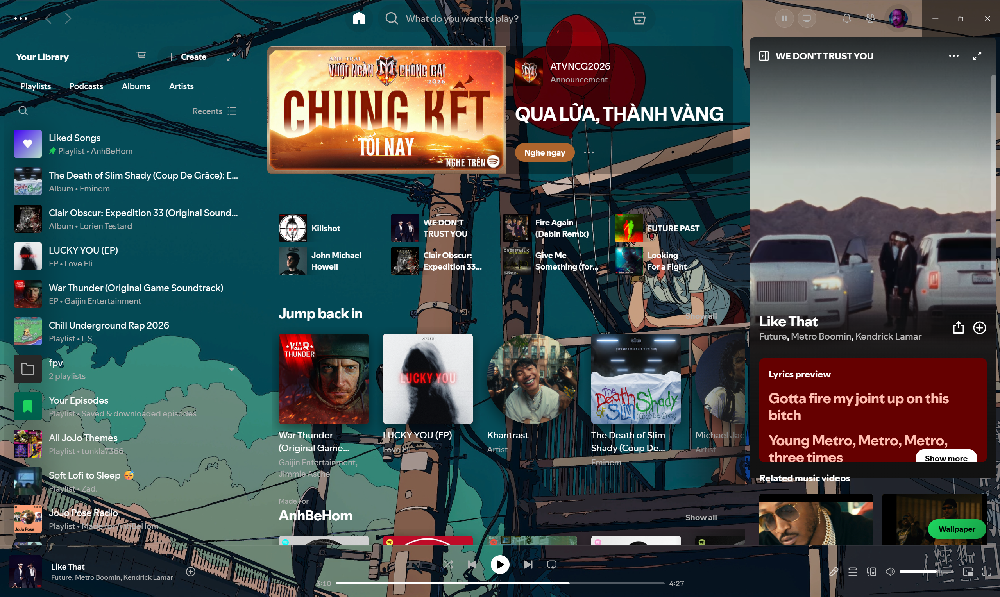
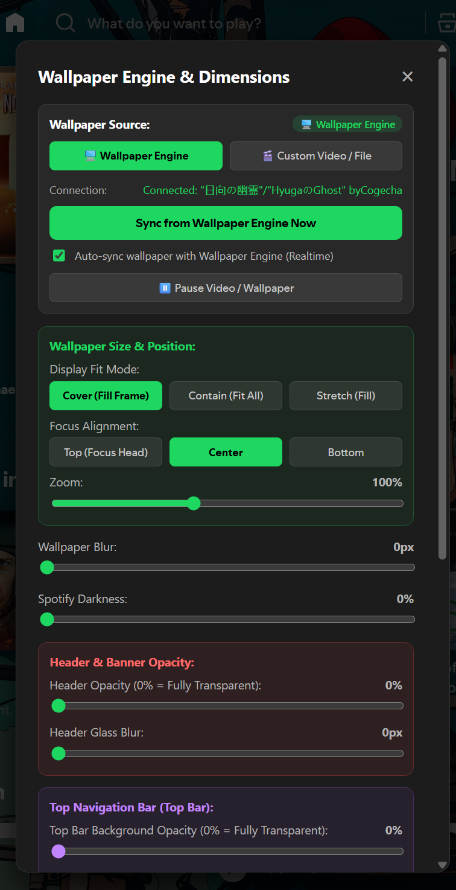
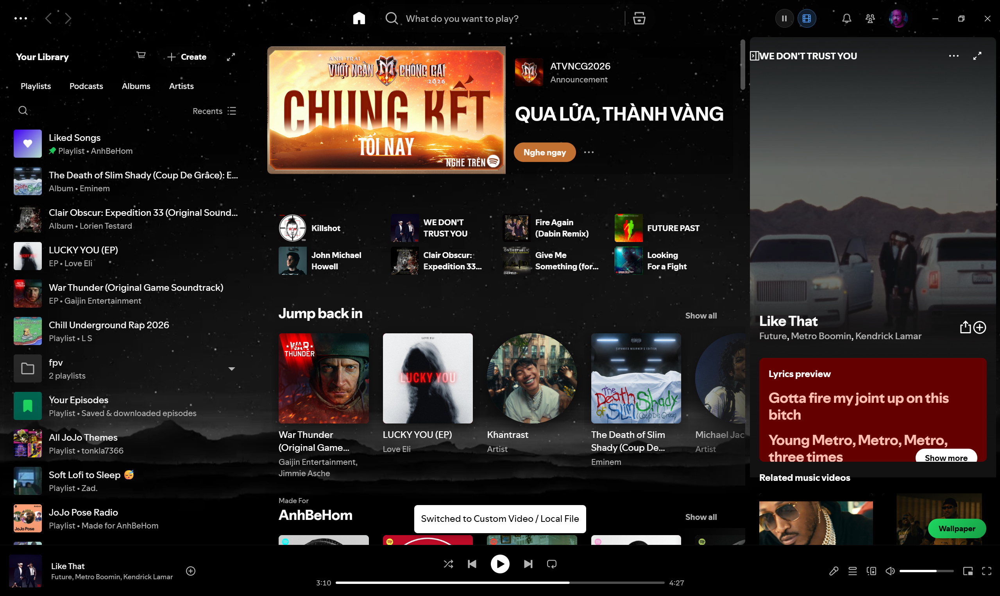

# Wallpaper Engine for Spotify

[](https://spicetify.app)
[](LICENSE)
[](https://github.com/POWER4392/Spotify---Wallpaper-Engine)

A high-performance Spicetify extension and native Windows synchronization service that brings active **Wallpaper Engine** desktop backgrounds (live streaming WebM videos, composited scene artwork, high-resolution snapshots, and static images) or personal **Custom Looping Videos (.webm, .gif)** directly into the Spotify client. Built with GPU-accelerated glassmorphism, dynamic album cover color tinting, and collision-aware scroll mechanics.



---

## Overview & Architecture

Standard Spotify desktop themes are static and cannot interact with the operating system desktop environment. This project bridges the gap by implementing a two-tier architecture:

1. **Frontend Client Layer (Spicetify Extension)**:
   * Injected directly into Spotify's Chromium Embedded Framework (CEF) runtime.
   * Renders background media layers beneath Spotify's DOM tree without interfering with UI event bubbling or playback controls.
   * Utilizes CSS custom property tokens for real-time frosted glass effects (`backdrop-filter: blur()`).
   * Manages local offline video assets using browser-native IndexedDB storage.
   * Extracts dominant color palettes from active albums in real time to adapt ambient interface accents.

2. **Backend Synchronization Service (Local Sync Bridge)**:
   * A lightweight, zero-dependency HTTP server running locally on `127.0.0.1:43196`.
   * Automatically discovers Wallpaper Engine installations across all system drives and active Windows processes.
   * Reads active display configurations from Steam workshop item manifests (`project.json`, `scene.json`).
   * For Wallpaper Engine video wallpapers, streams live looping WebM videos directly over HTTP 206 range streaming, or captures crisp Full HD frame snapshots for MP4 files lacking CEF H.264 codec support.
   * For Wallpaper Engine scene packages (`.pkg`), unpacks texture assets and reconstructs a high-resolution composited background visual using embedded native utilities.
   * Automatically starts and stops alongside the Spotify client process via background Windows script hooks.

```text
+-------------------------------------------------------------------+
|                        Windows Desktop                            |
|                                                                   |
|   +-----------------------+           +-----------------------+   |
|   |   Wallpaper Engine    |           |    Spotify Client     |   |
|   |  (Active Desktop BG)  |           |     (CEF Runtime)     |   |
|   +-----------+-----------+           +-----------^-----------+   |
|               |                                   |               |
|               | (config.json)                     | (HTTP API)    |
|               v                                   v               |
|   +-----------------------------------------------------------+   |
|   |             Local Native Sync Bridge                      |   |
|   |                 (127.0.0.1:43196)                         |   |
|   |                                                           |   |
|   |  * Multi-Drive Detection   * Scene Unpacker (RePKG)       |   |
|   |  * Process Watcher Daemon  * WebM Streamer & Frame Capture|   |
|   +-----------------------------------------------------------+   |
+-------------------------------------------------------------------+
```

---

## Detailed Features

### 1. Dual Wallpaper Source Engine

  * **Video Wallpapers**:
    * **WebM Video (`.webm`)**: Streams and plays the live looping video directly inside Spotify using native HTTP 206 range streaming and hardware acceleration.
    * **MP4 Video (`.mp4`)**: Because Spotify's CEF runtime does not include proprietary H.264 decoders, MP4 wallpapers are synchronized as high-definition Full HD snapshot frames (`video_frame.png`) by default. Convert any MP4 to WebM using `tools/convert-to-webm.bat` to enable full live video playback.
  * **Scene Wallpapers (`.pkg`)**: Wallpaper Engine scenes are complex proprietary DirectX shader applications that cannot run inside Spotify's web runtime. The sync bridge automatically unpacks the scene using RePKG and composites the multi-layer visual artwork into a high-resolution background image (`resolved_wallpaper.jpg`).
  * **Image Wallpapers (`.jpg`, `.png`, `.webp`, `.gif`)**: Directly loads and displays the original high-resolution wallpaper file.
  * Real-time polling watcher synchronizes transitions within three seconds of changing your desktop wallpaper.
  * Note: Some wallpapers may not function properly or may fail to display due to technical limitations. Compatibility will be improved in future updates.

* **Custom Video and Local File Mode (Animated Loop Mode)**:
  * This mode provides continuous animated video playback directly inside Spotify.
  * Allows loading your own looping videos (`.webm`) or animated GIFs (`.gif`) completely independent of Wallpaper Engine.
  * Media files are stored persistently in Spotify's internal IndexedDB database, persisting across app restarts and reboots.
  * Supports drag-and-drop file ingestion anywhere inside the Spotify client window.

### 2. Frosted Glass Glassmorphism System

* Dynamic translucency layers applied across Spotify's major layout surfaces:
  * Top Navigation Bar (Header)
  * Left Navigation Sidebar (Your Library)
  * Right Sidebar (Now Playing View and Friend Activity)
  * Bottom Player Controls Bar
  * Search Bar Floating Dropdown and Quick Search Results
* Real-time CSS variable bindings allow granular adjustments without requiring page reloads:
  * `--we-bg-opacity`: Global background darkening level
  * `--we-sidebar-opacity`: Left sidebar transparency
  * `--we-player-opacity`: Bottom playback bar transparency
  * `--we-header-opacity`: Main view header transparency
  * `--we-header-blur`: Header backdrop blur strength
  * `--we-topbar-opacity`: Global navigation bar transparency
  * `--we-topbar-blur`: Global navigation bar backdrop blur strength
  * `--we-img-blur`: Wallpaper background blur filter
  * `--we-img-brightness`: Wallpaper background brightness level
  * `--we-zoom`: Background scaling percentage

### 3. Real-Time Dynamic Color Extraction

* Uses a two-stage palette sampling algorithm:
  * Queries Spicetify's native `colorExtractor` API for the current track URI.
  * Falls back to DOM canvas sampling (`canvas.getContext("2d")`) to extract dominant vibrant colors from album artwork elements.
* Dynamically updates `--we-page-color` in the root document style sheet.
* Tints tracklist headers, category pills, and ambient page highlights to match the visual aesthetic of the music playing.

### 4. Collision-Aware Scroll Mechanics

* Continuously calculates the bounding rectangle of the album action bar relative to the top viewport edge.
* Automatically increases header background opacity and activates backdrop blur only after the album cover has scrolled past the viewport threshold.
* Pins sticky tracklist headers at the exact height of the top navigation bar, preventing visual clipping and text collisions.

### 5. Quick Top Bar Controls

* Top bar action buttons injected into Spotify's global navigation cluster:
  * Pause and Resume button: Instantly pause background video rendering to reduce GPU usage during gaming or work.
  * Source Toggle button: Switch back and forth between active desktop Wallpaper Engine sync and custom video mode with one click.
  * Sidebar Marketplace shortcut: Quick navigation icon inside Your Library header to open the Spicetify Marketplace.

---

## Installation & Setup Guide

### Method 1: Via Spicetify Marketplace (Recommended)

1. Open **Spotify**.
2. Click the **Marketplace** tab located in the left sidebar.
3. Switch to the **Extensions** sub-tab.
4. Search for **`Wallpaper Engine for Spotify`**.
5. Click **Install**. Spotify will automatically reload with the extension active.

---

### Method 2: Manual Installation via Spicetify CLI

If you prefer to install without the Marketplace UI, open PowerShell and execute:

```powershell
Invoke-WebRequest -Uri "https://raw.githubusercontent.com/P0WER/spotify-wallpaper/main/dist/wallpaper-engine.js" -OutFile "$env:APPDATA\spicetify\Extensions\wallpaper-engine.js"
spicetify config extensions wallpaper-engine.js
spicetify apply
```

---

### Method 3: Full Desktop Wallpaper Engine Synchronization Setup

To enable real-time synchronization with active Wallpaper Engine wallpapers from your desktop:

1. Clone or download this repository to any directory on your computer:
   ```powershell
   git clone https://github.com/P0WER/spotify-wallpaper.git
   cd spotify-wallpaper
   ```

2. **Start the Sync Bridge**:
   * Run `start-sync.bat` to launch the bridge in a console window.
   * Or run `start-sync.bat --silent` to start the bridge completely hidden in the background.

3. **Configure Automatic Startup with Spotify (Optional)**:
   * Run the automated setup script:
     ```powershell
     npm run setup
     ```
   * What this configuration does:
     * Updates your Desktop and Start Menu Spotify shortcuts to launch through `launch-spotify.vbs`.
     * Checks if the sync bridge is already running when you open Spotify; if not, it launches the bridge silently before opening Spotify.
     * Configures a lightweight background watcher (`watch-spotify-silent.vbs`) in your Windows Startup folder to ensure the bridge is always ready whenever Spotify is launched.

4. **Restoring Default Shortcuts**:
   * If you ever want to revert your Spotify shortcuts back to normal:
     ```powershell
     npm run uninstall
     ```

---

## How to Use & Customization

### Keyboard Shortcuts

| Shortcut | Action |
| :--- | :--- |
| <kbd>Ctrl</kbd> + <kbd>Shift</kbd> + <kbd>W</kbd> | Open or close the Wallpaper Settings modal dialog |
| <kbd>Ctrl</kbd> + <kbd>Shift</kbd> + <kbd>P</kbd> | Pause or resume video and wallpaper playback |
| <kbd>Ctrl</kbd> + <kbd>Shift</kbd> + <kbd>S</kbd> | Toggle between Wallpaper Engine sync and Custom Video mode |

### Custom Video Ingestion

* **Drag and Drop**: Drag any supported video (`.webm`, `.gif`) or image file from Windows Explorer directly onto the Spotify window.
* **File Picker**: Press <kbd>Ctrl</kbd> + <kbd>Shift</kbd> + <kbd>W</kbd> -> Select **Custom Video / File** -> Click **Select / Change Video File**.

### In-App Settings Dialog

Press <kbd>Ctrl</kbd> + <kbd>Shift</kbd> + <kbd>W</kbd> or click the floating **Wallpaper** button in the bottom right corner of Spotify to open the customization dialog:

<p align="center">
  
</p>

Configurable settings include:
* **Display Fit Mode**: Cover (Fill frame), Contain (Fit all without cropping), Stretch (Fill dimensions).
* **Focus Alignment**: Top (Focus on upper portion), Center, Bottom.
* **Zoom**: Scale from 60% to 160%.
* **Wallpaper Blur**: Adjust background blur from 0px to 30px.
* **Spotify Darkness**: Adjust background overlay darkness from 0% to 90%.
* **Header and Banner Opacity / Glass Blur**: Adjust header transparency and blur.
* **Top Navigation Bar Opacity / Glass Blur**: Adjust top bar transparency and blur.
* **Sidebar and Player Bar Opacity**: Independently adjust left sidebar and bottom player bar transparency.
* **Search Dropdown Color and Opacity**: Pick custom hex colors or presets (Default, Pitch Black, Navy Dark, Dark Pine, Deep Purple).
* **Wallpaper Brightness**: Adjust background brightness from 20% to 150%.

### Mode Switching Demonstration

Switch between desktop Wallpaper Engine sync and your custom personal video loop with instant notification toasts:

<p align="center">
  
</p>

---

## Video Compatibility & Codec Technical Guide

Spotify desktop client runs on the Chromium Embedded Framework (CEF). Due to licensing restrictions, Spotify's CEF build **does not include proprietary H.264 / AAC video decoders**.

* **Supported Animated Video Formats**:
  * **WebM (`.webm`)**: Encoded with VP8 or VP9 video codecs. Highly recommended for smooth playback and low CPU/GPU usage.
  * **Animated GIF (`.gif`)**: Fully supported natively.
* **Unsupported Video Formats**:
  * Standard `.mp4` (H.264) files will fail to decode inside Spotify's CEF player element, triggering a playback error notification.

### Using the Included 1-Click Video Converter

This repository includes a batch conversion utility located at `tools/convert-to-webm.bat`.

* **Usage**: Drag and drop any `.mp4`, `.mov`, or `.mkv` file directly onto `tools/convert-to-webm.bat`.
* **Technical details**:
  * Strips unused audio tracks to reduce memory consumption.
  * Scales resolution to 1080p (`scale=1920:-2`).
  * Encodes using `libvpx` with real-time encoding presets (`-cpu-used 8 -deadline realtime`).
  * Automatically detects local `tools/ffmpeg/ffmpeg.exe` or system-installed `ffmpeg` in your PATH.

---

## Developer Commands

| Command | Action |
| :--- | :--- |
| `npm run build` | Compiles source files into `dist/wallpaper-engine.js` and deploys to Spicetify Extensions |
| `npm run watch` | Watches `src/` for file changes and triggers automated incremental rebuilds |
| `npm run apply` | Builds the bundle and executes `spicetify apply` to reload Spotify |
| `npm run start` | Runs the Wallpaper Engine sync bridge in a visible PowerShell window |
| `npm run start:silent` | Runs the Wallpaper Engine sync bridge silently in the background |
| `npm run setup` | Configures automated Windows shortcuts and registry autostart hooks |
| `npm run uninstall` | Restores standard Spotify shortcuts and removes autostart entries |
| `npm run clean` | Deletes generated logs and build output |

---

## Troubleshooting & FAQ

<details>
<summary><b>Why does my MP4 video display a playback error inside Spotify?</b></summary>
<br>
Spotify's Chromium Embedded Framework (CEF) runtime lacks proprietary H.264 codecs. Convert your video to <code>.webm</code> (VP8/VP9) or <code>.gif</code>. Drag and drop your file onto <code>tools/convert-to-webm.bat</code> to convert it automatically.
</details>

<details>
<summary><b>Why does the connection status display "Bridge is not running"?</b></summary>
<br>
This status indicates that Spotify is set to Wallpaper Engine sync mode, but the local background HTTP bridge service has not been launched.
<br><br>
<b>Resolution</b>:
1. Double-click <code>start-sync.bat</code> in the project directory, OR
2. Press <kbd>Ctrl</kbd> + <kbd>Shift</kbd> + <kbd>S</kbd> to toggle to <b>Custom Video</b> mode if you only want to use personal video loops without desktop Wallpaper Engine synchronization.
</details>

<details>
<summary><b>How does Wallpaper Engine sync handle animated scenes and videos?</b></summary>
<br>
1. <b>Video Wallpapers (.webm)</b>: Streamed live using native HTTP 206 range streaming and played continuously as an animated video loop inside Spotify with full hardware acceleration.
<br><br>
2. <b>Video Wallpapers (.mp4)</b>: Because Spotify CEF excludes proprietary H.264 decoders, the sync bridge automatically extracts a crisp Full HD frame snapshot (video_frame.png) so Spotify displays high-resolution visuals without decoding errors. Run <code>tools/convert-to-webm.bat</code> on any MP4 file to convert it to WebM for live video playback.
<br><br>
3. <b>Scene Wallpapers (.pkg)</b>: Scenes are proprietary DirectX shader applications that cannot execute in Spotify's web environment. The sync bridge decompiles and composites the visual layers into a high-resolution artwork image (resolved_wallpaper.jpg).
<br><br>
4. <b>Custom Media / Local File Mode</b>: Plays personal looping videos (<code>.webm</code>, <code>.gif</code>) or displays high-resolution static images (<code>.png</code>, <code>.jpg</code>, <code>.webp</code>) completely independent of Wallpaper Engine.
</details>

<details>
<summary><b>Can the sync bridge find Wallpaper Engine if Steam is installed on a drive other than C:?</b></summary>
<br>
Yes. The sync service checks active processes (<code>wallpaper64.exe</code> / <code>wallpaper32.exe</code>), inspects the Windows Registry for Steam installation paths, and automatically scans all drive roots (<code>C:</code>, <code>D:</code>, <code>E:</code>, <code>F:</code>, etc.) for Steam Library folders.
</details>

<details>
<summary><b>Does this extension work with the Microsoft Store version of Spotify?</b></summary>
<br>
Yes. The launcher and autostart scripts automatically check for both standard standalone installations (<code>%APPDATA%\Spotify\Spotify.exe</code>) and Microsoft Store installations (<code>%LOCALAPPDATA%\Microsoft\WindowsApps\Spotify.exe</code>).
</details>

---

## License

This project is licensed under the [MIT License](LICENSE).
